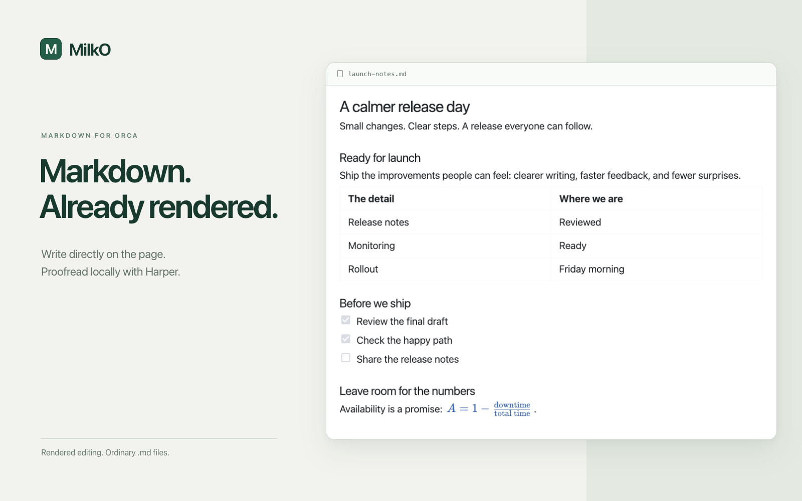

# MilkO Markdown

A rendered Markdown editor for [Orca](https://www.onorca.dev/), with local spelling
and grammar checks powered by Harper. Write and edit directly in the rendered view
while keeping your notes as ordinary Markdown files.

## What it does

- Rich text, headings, lists, tasks and tables.
- Code blocks with syntax highlighting and a copy button.
- Mermaid diagrams and mathematical notation.
- Find and replace, a document outline and heading links.
- Optional spelling and grammar checks with [Harper](https://writewithharper.com/),
  running locally on your computer.
- Careful Markdown preservation, with recoverable drafts when edits conflict.

## Make it yours

Open **Options** at the top right to choose Orca, Classic, Frame or Nord styling,
with light and dark appearances. Diagrams have their own theme choices, including
Forest, Neo and Redux. You can also adjust the text size and writing width, choose
an English dialect, add dictionary words or import a Weirpack.

**Find** opens search and replace. The outline button at the top left helps you
jump between headings. **Shortcuts**, beside Options, opens the keyboard reference
with the right keys for your platform.

Mermaid diagrams render automatically. Choose **Edit source** on a diagram to
change its code.

## Keeping your work

MilkO aims to preserve the Markdown you did not edit, including its formatting.
When an outside change cannot be combined safely with your typing, MilkO keeps a
recoverable draft for comparison. Use Orca's Compare/Reload controls to review
conflicts before overwriting a file.

Recovery drafts are never applied automatically. They can belong to another file
or contain text that was already saved, so check them before copying anything back.
The recovery panel shows how many copies are stored. **Dismiss all** clears those
copies after confirmation, while keeping your current editing checkpoint.

## Current status

MilkO 0.1.2 supports desktop Orca 1.4.251 or newer. Relative and remote
images, image uploads, project-file links and restoring the cursor position after
switching views are still being worked on. Read-only transitions have automated
coverage; verification of access changes in the desktop app remains limited.

## Credits

Built with [Milkdown and Crepe](https://milkdown.dev/), with editing and preservation
work adapted from [MilkJ](https://github.com/Bigsy/milkj).

[MIT licence](LICENSE) · [Third-party notices](THIRD_PARTY_NOTICES.md)
