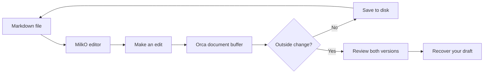
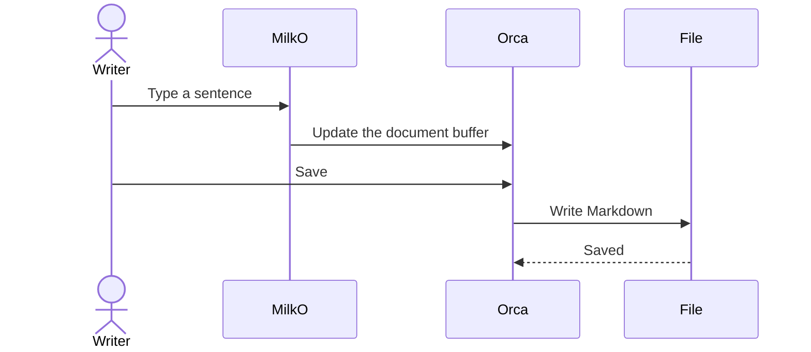

# MilkO playground

A page for trying **rich Markdown**, *formatting*, tables, tasks, code, maths and
Mermaid diagrams. Edit anything here and save it with **⌘S**.

Open **Options** at the top right to change appearance or configure proofreading.
Use **Find** or **⌘F** to search, and the outline button at the top left to navigate.

[Jump to maths](#maths) · [Jump to code](#code) · [Jump to the sequence diagram](#mermaid-sequence-diagram)

## Mermaid flowchart

The diagram renders below. Choose **Edit source** to change its Mermaid source.



## Try some formatting

This sentence has **bold**, *italics*, ~~strikethrough~~ and `inline code`.

Keep __this emphasis style__ when editing the sentence next to it.

> A good editor changes the words you edit and preserves the rest.

### Shopping list

* [ ] Pick up milk
* [ ] Make a cup of tea
* [x] Open the MilkO playground

1. Change a word in this page.
2. Save with **⌘S**.
3. Switch to Source and inspect the Markdown.
4. Switch back to MilkO.

## A small table

| Feature | Something to try |
| --- | --- |
| Prose | Add a sentence |
| Tasks | Tick a checkbox |
| Tables | Edit a cell |
| Code | Change the greeting below |
| Mermaid | Edit a diagram label |

## Code

```typescript
interface Greeting {
  name: string;
  favouriteDrink: string;
}

function greet(person: Greeting): string {
  return `Hello, ${person.name}! Time for ${person.favouriteDrink}.`;
}

greet({ name: "MilkO", favouriteDrink: "tea" });
```

## Maths

Inline: $a^2 + b^2 = c^2$.

$$
\sum_{k=1}^{n} k = \frac{n(n+1)}{2}
$$

## Mermaid sequence diagram



## Unicode and punctuation

Café, naïve, résumé, 日本語, Ελληνικά and a glass of milk 🥛.

“Curly quotes”, 'straight quotes', an em dash — and an ellipsis…

## Proofing playground

The next two sentences contain deliberate mistakes for Harper to find. Click an
underline to see suggestions, or add an unfamiliar word to your personal dictionary.

This is wierd.

A apple is on the table.

## HTML preview

<details>
<summary>A little more detail</summary>
<p>This is a <strong>sanitized HTML preview</strong>. The HTML remains intact in Source.</p>
</details>

---

End of the playground. Add another section here.
